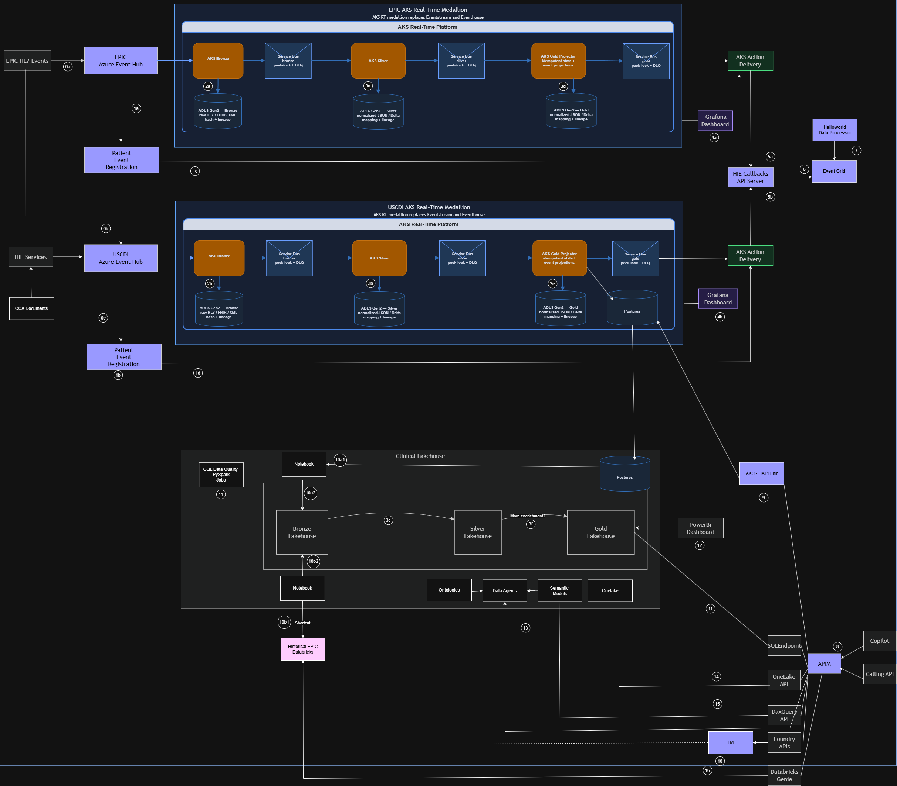
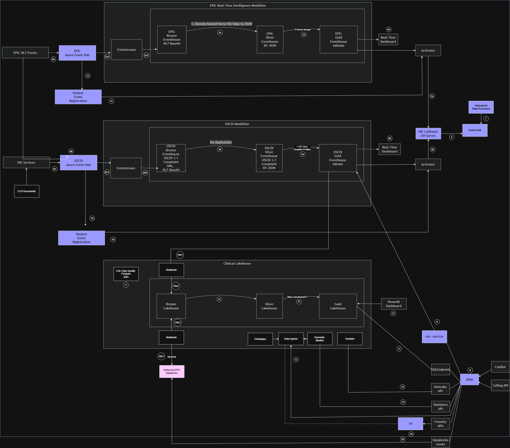
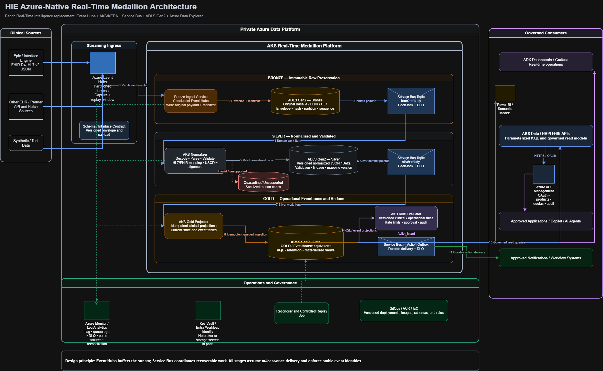

# HIE Solution Architecture

The current architecture direction is the **Changes-10 AKS real-time
medallion**: separate AKS pipelines for internal Epic HL7 and external USCDI
events, with PostgreSQL-backed Gold and the existing Fabric Clinical NRT
Lakehouse retained for analytics.



*Changes-10: latest architecture direction.*

The Changes-10 flow uses independent Azure Event Hubs for Epic and USCDI,
AKS-hosted Java workers, ADLS Gen2 Bronze/Silver, Service Bus stage handoffs,
and PostgreSQL Gold. HAPI FHIR provides FHIR access, with an opt-in JPA
integration for Gold writes and Silver patient matching. PostgreSQL-to-Fabric
replication is the target analytical flow; the existing Clinical NRT Lakehouse
remains part of the architecture.

See the [AKS architecture](./docs/azure-aks-medallion-architecture.md) and
[service guide](./services/aks-medallion/README.md) for implementation details.

## Related POCs

- [HAPI FHIR over Gold Eventhouse](./docs/fhir-gold-poc.md): an alternative
  Fabric-based FHIR access path, with its repurposed [Terraform
  deployment](./terraform), read-only HAPI R4 adapter, and synthetic ePNA
  lifecycle [Bundles and event files](./samples/epna).
- [Activator delivery service](./services/fabric-rt-actuator): Java/Spring
  webhook intake, durable Service Bus delivery, and Activator rule management.
  See [Epic ADT integration and setup](./docs/adt-activator.md) for scope and
  deployment boundaries.

| Document information | Value |
|---|---|
| Architecture status | POC architecture direction |
| Document type | Solution architecture |
| Date | 24 November 2026 |

## Architecture Statement

This document focuses on the Changes-10 AKS real-time direction for internal
Epic HL7 and external USCDI. The design uses PostgreSQL as operational Gold,
HAPI FHIR for resource access and JPA processing, and Fabric for analytical
replication while retaining the Clinical NRT Lakehouse. Earlier Fabric RT
and AKS/ADX designs remain alternatives and are identified as such.

## 1. Executive Summary

Separate AKS pipelines handle internal Epic HL7 and external USCDI events.
Event Hubs provide ingress, Java workers persist raw and normalized records in
ADLS Gen2, and Service Bus provides durable stage handoffs. Gold commits event
history and current FHIR state to PostgreSQL. HAPI FHIR provides resource
access; the opt-in HAPI JPA path supports Gold synchronization, exact
enterprise-identifier MDM matching in Silver, and FHIR subscriptions relayed
to Service Bus.

Fabric remains the analytical environment. PostgreSQL replication is the
intended bridge into Fabric, and the Clinical NRT Lakehouse remains in place.
The separate Fabric RT and AKS/ADX designs are documented as alternatives,
not as the primary Changes-10 topology.

## 2. Architecture Approach

| Area | Changes-10 direction |
|---|---|
| Ingress | Separate Azure Event Hubs receive internal Epic HL7 and external USCDI streams. |
| Raw preservation | AKS Bronze workers preserve incoming payloads and metadata in ADLS Gen2. |
| Normalization | AKS Silver workers process supported JSON/FHIR records and retain Bronze lineage. |
| Medallion handoffs | Azure Service Bus separates and coordinates recoverable processing stages. |
| Operational Gold | PostgreSQL holds Gold event history and current FHIR state. |
| FHIR and identity | HAPI FHIR serves resources; opt-in JPA integration supports writes and exact enterprise-identifier MDM matching. |
| Analytics | PostgreSQL replication into Fabric is the target analytical flow; the Clinical NRT Lakehouse remains. |
| Notifications | FHIR subscriptions can send REST-hook notifications to a Service Bus relay. |

### 2.1 Real-Time Platform Alternatives

Changes-10 is the focus of this document. The earlier AKS/ADX and Fabric RT
designs remain alternatives for specific serving and analytics needs.

| Dimension | Changes-10: AKS + PostgreSQL + Fabric | AKS + ADX alternative | Fabric RT alternative |
|---|---|---|---|
| Real-time processing | Separate AKS Java pipelines for Epic and USCDI | AKS Java pipelines | Fabric Eventstream and Eventhouse |
| Gold system of record | PostgreSQL | Azure Data Explorer | Eventhouse |
| FHIR and patient identity | HAPI FHIR with opt-in JPA/MDM integration | Requires a separately designed FHIR integration | Separate read-only HAPI/Eventhouse POC |
| Fabric role | Analytical replica and retained Clinical NRT Lakehouse | Not required for the RT data plane | Real-time and analytical platform |
| Stage handoffs | Service Bus | Service Bus | Fabric-managed processing |
| Primary strength | PostgreSQL-backed operational state with Fabric analytics | KQL-oriented operational serving | Integrated managed real-time analytics |

## 3. Logical Architecture

Changes-10 is the primary design here; the earlier Fabric RT and AKS/ADX
designs are retained below as alternatives.

### 3.1 Changes-10: AKS, PostgreSQL, and Fabric Analytics

*The Changes-10 diagram above shows the overall topology.*

| Source | Ingest | Bronze | Transform | Silver | Gold | Consumers |
|---|---|---|---|---|---|---|
| Internal Epic HL7 and external USCDI | Separate Azure Event Hubs | ADLS Gen2 raw payload and manifest | AKS Java normalization workers | ADLS Gen2 normalized JSON with lineage | AKS projector to PostgreSQL | HAPI FHIR, APIs, and Fabric analytics via the planned replication path |

#### Changes-10 End-to-End Data Flow

1. Epic and partner systems publish events to their dedicated Event Hubs.
2. AKS Bronze workers checkpoint ingress and persist payloads and metadata to ADLS Gen2.
3. Service Bus hands committed Bronze records to the Silver workers.
4. Silver workers process supported JSON/FHIR resources, apply configured patient identity matching when enabled, and hold unresolved matches for review.
5. Silver records are stored in ADLS Gen2 with lineage to Bronze.
6. Service Bus hands Silver records to the Gold projectors.
7. Gold commits event history and current FHIR state to PostgreSQL.
8. HAPI FHIR exposes FHIR resources; the opt-in JPA integration synchronizes through FHIR APIs and supports subscriptions.
9. PostgreSQL data is intended to replicate to Fabric for governed analytics. The Clinical NRT Lakehouse remains available to its existing consumers.

The [AKS architecture document](./docs/azure-aks-medallion-architecture.md)
covers PostgreSQL replication and the retained Clinical NRT Lakehouse. The
[service guide](./services/aks-medallion/README.md) describes the Java
implementation, configuration, and operational boundaries.

### 3.2 Alternative: Microsoft Fabric Real-Time Intelligence



*Figure 2. Earlier Fabric RT alternative.*

The separate Fabric RT POC uses Eventstream and Eventhouse for ingestion,
transformation, and operational analytics, with OneLake for analytical
consumption. It is an alternative to the Changes-10 AKS real-time processing
path, rather than the primary topology described here. See the [Fabric FHIR
POC](./docs/fhir-gold-poc.md) for its implementation details.

### 3.3 Alternative: AKS + ADLS + ADX



*Figure 3. AKS/ADX alternative.*

This earlier AKS option uses ADX for KQL-oriented operational serving instead
of PostgreSQL-backed HAPI FHIR and Fabric replication. The editable architecture
is [hie.drawio](./hie.drawio), page Changes-10, and the [AKS implementation
guide](./services/aks-medallion/README.md) describes the available service
backends.

## 4. Component Architecture

| Component | Role | Responsibility |
|---|---|---|
| Epic HL7 and external USCDI sources | Clinical sources | Publish events into their separately configured pipelines. |
| Azure Event Hubs | Ingress broker | Buffers partitioned events for the Bronze workers. |
| AKS Java workloads | Processing | Independently run Bronze ingestion, Silver normalization, and Gold projection. |
| Azure Data Lake Storage Gen2 | Bronze and Silver persistence | Preserves source payloads, normalized records, and their lineage. |
| Azure Service Bus | Stage handoffs | Coordinates durable processing and dead-letter handling between stages. |
| PostgreSQL | Operational Gold | Stores Gold event history and current FHIR resource state. |
| HAPI FHIR JPA | FHIR and patient identity | Provides FHIR API integration, Gold resource synchronization, and opt-in Silver MDM matching. |
| HAPI subscription relay | Notification handoff | Publishes REST-hook notifications to Service Bus after successful broker delivery. |
| Fabric and Clinical NRT Lakehouse | Analytics | Receives the planned analytical replica and retains existing NRT analytics. |
| Azure API Management | API boundary | Provides the managed access boundary for approved external API consumers. |

## 5. Data Architecture

### 5.1 Bronze

- Immutable or append-oriented retention of the received event and envelope.
- Capture event ID, correlation ID, message control ID where available, source, event time, ingestion time, partition, offset, schema version, payload hash, processing state, and regional metadata.
- Restrict access to platform operations, approved engineering, audit, and replay roles.
- Preserve original identifiers during replay and mark the replay attempt to support deduplication.

### 5.2 Silver

- Maintain one normalized JSON representation per supported message with explicit parse and validation status.
- Govern USCDI+ alignment through versioned mappings rather than inferring it at query time.
- Retain unrecognized fields where permitted so normalization does not silently discard source content.
- Link every Silver record to the Bronze event and transformation version.

### 5.3 Gold

- PostgreSQL is the operational Gold store for event history and current FHIR resources.
- The HAPI JPA integration synchronizes resources through FHIR APIs; application code does not write directly to HAPI JPA tables.
- Preserve source-version ordering and replay behavior when updating current state.
- The intended Fabric replica supports analytics; PostgreSQL remains the operational write path.

## 6. Consumption and Data Egress

| Consumer | Technical path | Control point |
|---|---|---|
| FHIR applications | Client to APIM to HAPI FHIR | OAuth, resource-level authorization, audit, and throttling |
| Downstream event consumers | HAPI REST hook to relay to Service Bus | Authenticated relay, restricted queue permissions, consumer deduplication, and monitoring |
| Power BI and Fabric analytics | PostgreSQL analytical replica to Fabric/Clinical NRT Lakehouse | Fabric identity, workspace and item permissions, and governed semantic models |
| Copilot and Foundry applications | Approved API or governed Fabric data source | Least-privilege tool scope, user authorization, content controls, and audit |

APIM fronts supported backend APIs; it does not itself execute arbitrary SQL or
query Fabric data. HAPI FHIR is an explicit API backend, while analytical
consumers use the governed Fabric replica and its supported access patterns.

## 7. Security, Privacy, and Compliance Architecture

- Use Microsoft Entra ID identities and managed identities for service-to-service access. Keep secrets in an approved secret store.
- Apply least-privilege access to AKS workloads, Event Hubs, Service Bus, ADLS Gen2, PostgreSQL, HAPI FHIR, Fabric, and APIs.
- Isolate the Epic and USCDI pipelines, storage paths, queues, database access, and workload identities.
- Encrypt data in transit and at rest using platform capabilities and organization-approved key-management requirements.
- Classify clinical data, minimize fields delivered to each consumer, and enforce consumer authorization at the semantic/API layer.
- Keep PHI out of operational logs where possible. Store identifiers, hashes, status codes, and correlation values sufficient for support and lineage.
- Validate private connectivity requirements for Event Hubs, AKS, PostgreSQL, HAPI FHIR, Service Bus, ADLS, Fabric, and API backends.
- Conduct threat modeling for ingestion spoofing, malformed payloads, replay abuse, over-broad SQL/API access, API enumeration, agent prompt injection, and unintended analytical disclosure.

## 8. Reliability, Resilience, and Operations

| Concern | Design requirement |
|---|---|
| Idempotency | Use stable event and message identifiers plus payload hashes; stage processors and HAPI synchronization must tolerate replay. |
| Poison events | Dead-letter invalid or unsupported events with sanitized diagnostics while preserving the Bronze source event. |
| Checkpointing | Track Event Hubs checkpoints and Service Bus queue depth/age independently for each pipeline and stage. |
| Schema evolution | Version event envelopes, supported clinical mappings, FHIR resources, PostgreSQL schema, Fabric replica, and APIs. |
| Reconciliation | Compare Bronze received, Silver processed/held, Gold committed, and Fabric replicated counts over controlled windows. |
| Monitoring | Track ingestion lag, processing failures, dead letters, Gold freshness, HAPI/API latency, subscription relay delivery, and replication lag. |
| Recovery | Document replay boundaries, PostgreSQL recovery, queue re-drive, HAPI recovery, Fabric replication restart, and operator ownership. |
| Regional resilience | Validate regional topology, failover authority, subscription state, RTO/RPO, and duplicate behavior. |

## 9. Implementation Validation Areas

| Area | Name | Primary outcome |
|---|---|---|
| 1 | Epic and USCDI ingress | Verify isolated Event Hubs, identities, checkpoints, and source contracts. |
| 2 | Bronze persistence and replay | Verify ADLS durability, metadata, lineage, and replay behavior. |
| 3 | Silver processing and identity | Verify supported input handling, exact enterprise-identifier matching, and unresolved-match holds. |
| 4 | PostgreSQL Gold | Verify event/current-state consistency, version ordering, conflict handling, and replay safety. |
| 5 | HAPI FHIR JPA | Verify FHIR API synchronization, MDM behavior, identity controls, and recovery procedures. |
| 6 | FHIR subscriptions | Verify REST-hook handling, Service Bus delivery, retries, deduplication, and monitoring. |
| 7 | Fabric analytics | Validate PostgreSQL replication, schema compatibility, replication lag, and Clinical NRT Lakehouse integration. |
| 8 | Security and operations | Validate access controls, observability, recovery, runbooks, and ownership across both pipelines. |

## 10. Cross-Implementation Acceptance Criteria

- **Functional:** Supported events complete the full Bronze-to-Silver-to-Gold path and retain lineage.
- **Performance:** Measured throughput, event size, burst, transformation latency, dashboard freshness, materialization latency, and API response times are recorded against agreed targets.
- **Quality:** Mapping completeness, parse failures, data-quality exceptions, duplicates, and reconciliation results are visible.
- **Security:** Unauthorized identities, fields, queries, API routes, and agent sources are rejected and audited.
- **Reliability:** Replay, duplicate delivery, malformed payload, dependency outage, throttling, checkpoint restart, and partial failure scenarios are exercised.
- **Operations:** Dashboards and runbooks identify owners, alerts, diagnostic queries, recovery steps, and escalation paths.
- **Outcome:** Each validation area ends with a documented pass, conditional pass, or fail and records any architecture change required.

## 11. Implementation Workstreams

| Workstream | Key outputs |
|---|---|
| Azure platform foundation | AKS, Event Hubs, Service Bus, ADLS Gen2, PostgreSQL, network, and identity design |
| Source and clinical contracts | Event envelopes, supported HL7/USCDI inputs, FHIR profiles, identifier system, and mapping rules |
| Medallion processing | Bronze persistence, Silver normalization, Gold projection, lineage, replay, and dead-letter handling |
| FHIR and patient identity | HAPI JPA deployment, exact-identifier MDM rules, review workflow, subscriptions, and relay |
| Fabric analytics | PostgreSQL replication, Clinical NRT Lakehouse integration, schema controls, and consumer access |
| Security and operations | Threat model, access matrix, monitoring, reconciliation, disaster recovery, runbooks, and ownership |

## 12. Assumptions, Constraints, and Open Implementation Topics

- Changes-10 is the current POC architecture direction; the Fabric RT and AKS/ADX paths are alternatives.
- Gold PostgreSQL is the operational write path. The Fabric replica is intended for analytical consumption, not clinical writes.
- Supported HL7 versions, message families, and USCDI mapping rules must be selected and validated before clinical processing.
- Capacity sizing requires measured event rates, peak/burst factor, payload size, retention, PostgreSQL workload, replication lag, query demand, and API volume.
- FHIR subscriptions and the Service Bus relay establish the notification path; production delivery guarantees, recovery, and clinical workflow behavior require operational validation.
- RTO, RPO, data residency, retention, private networking, customer-managed key requirements, and regulated-data controls must be confirmed with the responsible governance teams.

## 13. Architecture Governance

Any proposed change to ingress, Bronze/Silver/Gold boundaries, transformation location, PostgreSQL-to-Fabric replication, semantic access, API exposure, or identity model must be recorded in an architecture record. The change must identify affected implementation areas, security and privacy impact, migration impact, rollback approach, and diagram/document updates before implementation.

## Appendix A. Architecture Traceability

The following traceability notes apply to the earlier Fabric RT alternative,
not the Changes-10 primary architecture.

| Architecture element | Rationale |
|---|---|
| Single Event Hub input | Avoids a duplicate normalized Event Hub when decoding and normalization can be evaluated inside the Fabric processing path. |
| Eventhouse Bronze/Silver/Gold | Keeps real-time ingestion, KQL transformation, operational query, and dashboard functionality in the Real-Time Intelligence plane. |
| Lakehouse/OneLake analytical branch | Provides durable Delta-based analytical consumption and a foundation for Power BI and semantic interoperability. |
| Separate semantic layer | Prevents each consumer from independently interpreting clinical fields and relationships. |
| APIM boundary | Centralizes API authentication, policy, throttling, versioning, and observability while backend adapters constrain data access. |
| Eight validation areas | Reduces architecture risk by validating each major boundary independently and then as an end-to-end path. |

## Appendix B. Source and Architecture Basis

The appendix material below records a separate Fabric RT/Activator POC and is
not the Changes-10 AKS real-time topology. Changes-10 is described in the
overview, logical architecture, and AKS service guide above.

## ePNA Activator Alert Implementation

The deployment implementation is in [`infra/`](./infra). Bicep remains the deployment entry point. Fabric **capacity** is a native Azure Resource Manager resource; optionally provision a paid F2 with [`infra/capacity.bicep`](./infra/capacity.bicep). Because Fabric workspaces, Eventhouses, KQL databases, and Activator items are Fabric SaaS resources rather than Azure Resource Manager resources, the Bicep deployment script uses a pre-authorized managed identity to call the supported Fabric REST APIs.

The deployment creates or reconciles:

1. A Gold Fabric workspace assigned to an existing Fabric capacity.
2. A Gold Eventhouse and read/write KQL database.
3. The KQL schema in [`fabric/kql/DatabaseSchema.kql`](./fabric/kql/DatabaseSchema.kql).
4. An Activator/Reflex item that polls `EpnaAlertCandidates()` every 60 seconds.
5. An email rule that fires when an active emergency encounter transitions to a clinician-approved ePNA-qualified signal.

The deployment also creates a custom-endpoint Gold FHIR Eventstream using the
[direct-ingestion definition](./fabric/eventstream/GoldFhirEventstream.template.json).
It writes one resource or monitoring envelope per event into `GoldFhirEvent`;
transactional update policies populate the canonical and typed Gold tables.
Invalid envelopes are visible in `GoldFhirRejectedEvent`. See the
[FHIR/ePNA runbook](./docs/fhir-gold-poc.md) for publishing and acceptance checks.
The alert query now selects the latest encounter signal **before** applying
eligibility filters, so an older qualified signal cannot supersede discharge,
transfer or non-qualification.

### Standards boundary

FHIR does not have a "FHIR v2" release. This implementation preserves source **HL7 v2** message version and provenance, then represents Gold clinical entities as **FHIR R4 (4.0.1)** resources using versioned US Core profile canonicals and explicit USCDI/USCDI+ mapping metadata. USCDI+ is a program with domain datasets, not a single FHIR profile. `MappingVersion`, `UscdiVersion`, `UscdiPlusDomain`, and `TerminologyVersion` therefore remain explicit and governed rather than being inferred.

The generic `GoldFhirResource` table retains the canonical FHIR JSON and lineage. Typed Patient, Encounter, Condition, Observation, ServiceRequest, DiagnosticReport, and Provenance projections provide stable row-and-column entities for semantic interoperability, semantic models, and data agents. Terminology-bearing fields always store both system and code; production mappings must bind approved SNOMED CT, LOINC, RxNorm, ICD-10-CM, and local-code translations through the governed terminology service.

### Alert safety boundary

The implementation does not diagnose pneumonia and does not invent clinical scoring thresholds. `EpnaAlertCandidates()` only returns an alert when an upstream, versioned qualification policy has emitted all of the following:

- `AlertEligible == true`
- `MonitoringStatus == "qualified"`
- `EncounterStatus == "in-progress"`
- `EncounterClassCode == "EMER"`

The email excludes direct patient identifiers. Activator demonstrates operational detection and action delivery only; it is not the durable clinical subscription, escalation, acknowledgement, or guaranteed-delivery system.

### Prerequisites

- An existing Fabric capacity and its Fabric capacity UUID, or a paid capacity provisioned with the optional deployment below.
- A user-assigned managed identity enabled in the Fabric tenant setting for service principals.
- Permission for that identity to create workspaces and assign them to the selected capacity.
- The identity must become Workspace Admin/Contributor through the workspace-creation flow so it can create items.
- An Azure principal permitted to deploy `Microsoft.Resources/deploymentScripts` with that identity.

Copy [`infra/main.example.bicepparam`](./infra/main.example.bicepparam) to `infra/main.bicepparam`, replace the placeholders, and deploy:

```powershell
az deployment group create `
  --resource-group <resource-group> `
  --template-file .\infra\main.bicep `
  --parameters .\infra\main.bicepparam
```

`enableActivatorRule` defaults to `false`. Load the synthetic row from [`fabric/kql/SampleData.kql`](./fabric/kql/SampleData.kql), validate the query and notification ownership, then redeploy with the rule enabled. Never put production identifiers in the sample file or non-production workspace.

### Optional paid F2 capacity

[`infra/capacity.bicep`](./infra/capacity.bicep) deploys `Microsoft.Fabric/capacities@2023-11-01` and defaults to **F2 (2 capacity units)**. Capacity creation is deliberately separate from [`infra/main.bicep`](./infra/main.bicep): the existing trial deployment remains unchanged, and creating a paid resource requires an explicit deployment. The capacity template does not create workspaces, a managed identity, tenant permissions, or alerts.

Prerequisites:

- An Azure subscription in the **same Microsoft Entra tenant** as the target Fabric environment, with permission to create Fabric capacities and resource-group deployments.
- The `Microsoft.Fabric` resource provider registered in that subscription.
- A supported region and at least 2 available capacity units of quota for F2. The example uses `westcentralus`; verify regional support and data-residency requirements before deployment.
- At least one approved **tenant-member user's UPN** for the capacity administrator. B2B guest users cannot be capacity administrators.
- An approved budget: paid capacity starts incurring charges when provisioned. F2 is a small synthetic-test starting point, not a sizing recommendation for production HIE traffic.

Copy [`infra/capacity.example.bicepparam`](./infra/capacity.example.bicepparam) to [`infra/capacity.bicepparam`](./infra/capacity.bicepparam), which is excluded from Git. Review the capacity name, region, and SKU, then set the administrator UPN in the same shell:

```powershell
Copy-Item .\infra\capacity.example.bicepparam .\infra\capacity.bicepparam
$env:FABRIC_CAPACITY_ADMIN_UPN = '<tenant-member-admin-upn>'

# Review proposed Azure resource changes without creating the capacity.
az deployment group what-if `
  --resource-group <resource-group> `
  --template-file .\infra\capacity.bicep `
  --parameters .\infra\capacity.bicepparam

# Run only after approving the region, administrator, and paid-capacity cost.
az deployment group create `
  --name hie-fabric-capacity `
  --resource-group <resource-group> `
  --template-file .\infra\capacity.bicep `
  --parameters .\infra\capacity.bicepparam
```

After provisioning:

1. Confirm the capacity is active in Fabric. The template's `capacityResourceId` output is an **Azure resource path**, not the Fabric capacity UUID.
2. Obtain the new **Fabric capacity UUID** from the Fabric admin portal, or the `id` returned by `GET https://api.fabric.microsoft.com/v1/capacities` as an authorized user. Follow API pagination and verify the capacity name, region, SKU, and state; do not take an arbitrary first result.
3. Have the capacity administrator grant the deployment identity the required Fabric capacity assignment rights, and confirm its tenant permissions. Azure RBAC and the capacity's human-admin list do not automatically authorize the managed identity in Fabric.
4. Replace `fabricCapacityId` in your local [`infra/main.bicepparam`](./infra/main.bicepparam) with the new UUID. Keep the existing managed-identity and recipient requirements and `enableActivatorRule = false`.
5. Use a distinct `workspaceDisplayName`, such as `hie-gold-f2-demo`, or explicitly reassign the existing Gold workspace to the new capacity in Fabric first. The deployment rejects an existing workspace on a different capacity rather than silently keeping it on the trial; it does not perform a migration.
6. Run the existing Gold workspace deployment command above and complete the synthetic acceptance checks.

**Cost control:** pause the paid capacity in the Azure portal when the test environment is not in use, and resume it before testing. Pausing can make the assigned content unavailable, so do not expect continuous Activator monitoring while paused. Remaining smoothed usage/overages can be billed on pause, and storage and other Azure services have separate charges. Review current regional pricing rather than treating F2 or pause/resume as free.

**Data-agent capacity:** Microsoft's data-agent prerequisites include a **paid F2 or higher** capacity. F2 removes the trial-capacity limitation, but does not automatically enable or deploy a data agent. Tenant AI settings, regional/cross-geo policy, source access, and clinical governance still require review; this deployment does not change them.

References: [native Bicep capacity resource](https://learn.microsoft.com/en-us/azure/templates/microsoft.fabric/2023-11-01/capacities), [capacity provisioning prerequisites](https://learn.microsoft.com/en-us/fabric/enterprise/buy-capacity), [Fabric capacity UUID API](https://learn.microsoft.com/en-us/rest/api/fabric/core/capacities/list-capacities), [pause and resume](https://learn.microsoft.com/en-us/fabric/enterprise/pause-resume), and [data-agent prerequisites](https://learn.microsoft.com/en-us/fabric/data-science/concept-data-agent).

### Trial capacity: Activator validation only

An existing Fabric trial capacity can be used for real-time analytics validation, subject to its current status, tenant settings, and the deployment identity's permissions. Use the trial's **capacity UUID**, not an Azure resource ID. The deployment targets a dedicated Gold workspace; it does not modify the personal **My workspace** shown in the portal.

The environment-specific [`infra/main.bicepparam`](./infra/main.bicepparam) is excluded from Git. The local trial configuration contains the selected capacity UUID and keeps the Activator rule disabled. It reads the remaining deployment values from environment variables so missing values stop parameter compilation rather than deploying placeholder identities or recipients:

```powershell
$env:FABRIC_DEPLOYMENT_IDENTITY_RESOURCE_ID = '/subscriptions/<subscription-id>/resourceGroups/<identity-resource-group>/providers/Microsoft.ManagedIdentity/userAssignedIdentities/<identity-name>'
$env:EPNA_ALERT_RECIPIENT = '<approved-test-recipient>'
```

Set real values in the same shell used to run the deployment command above. The deployment still needs an Azure resource group and permission to use that managed identity. Fabric trial capacity does not provide those Azure resources, and the deployment script's supporting Azure resources can incur charges even though the Fabric capacity is a trial.

Before deployment:

- If the portal reports **"Your capacity admin is unavailable"**, ask a Fabric tenant administrator to reassign the capacity admin and verify assignment rights. Access to an existing workspace does not prove permission to assign a new workspace to that capacity.
- Confirm that the managed identity has the required Fabric tenant permissions and capacity Contributor/Admin access. Creating a user-assigned identity or granting Azure RBAC alone does not grant Fabric permissions.
- Confirm the trial's remaining lifetime in **OneLake catalog > Govern > Capacities**; preserve synthetic test evidence and plan capacity reassignment before expiry.
- Use synthetic data only. Trial limitations include unavailable Private Link and some other enterprise controls; a trial is not a production clinical environment.

**Data-agent deployment is deferred.** Microsoft documents that Fabric trial capacities do not support Fabric data agents. Retain the versioned clinical entities and provenance for later semantic work, then move to a supported paid capacity and validate the relevant tenant and regional prerequisites before deploying the data agent. No ontology, semantic model, or data agent is provisioned by this deployment.

References: [Fabric trial capabilities and expiry](https://learn.microsoft.com/en-us/fabric/fundamentals/fabric-trial), [features by capacity](https://learn.microsoft.com/en-us/fabric/enterprise/fabric-features), and [workspace creation permissions](https://learn.microsoft.com/en-us/rest/api/fabric/core/workspaces/create-workspace).

### Acceptance checks

1. Run `EpnaAlertCandidates()` before ingestion and confirm it returns no rows.
2. Ingest the synthetic sample with a current `EventTime`; update the included timestamp if needed.
3. Confirm exactly one candidate is returned for the synthetic encounter.
4. Enable the rule and confirm one email is delivered without a patient identifier.
5. Replay the same signal and verify the `BecomesGreaterThan` state transition suppresses a duplicate action.
6. Insert a non-qualified, non-emergency, ended, or `AlertEligible=false` signal and verify no action occurs.
7. Capture Activator run history, delivery latency, throttling behavior, ownership, and audit evidence.
