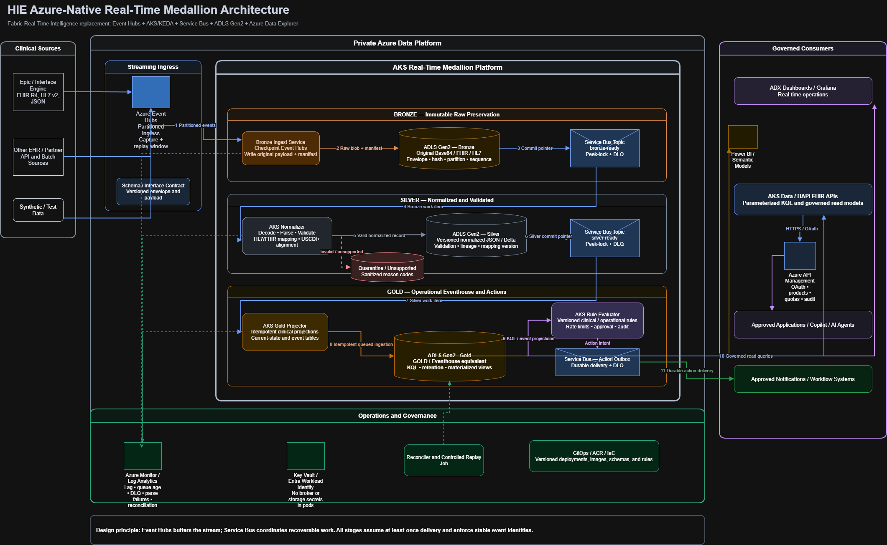
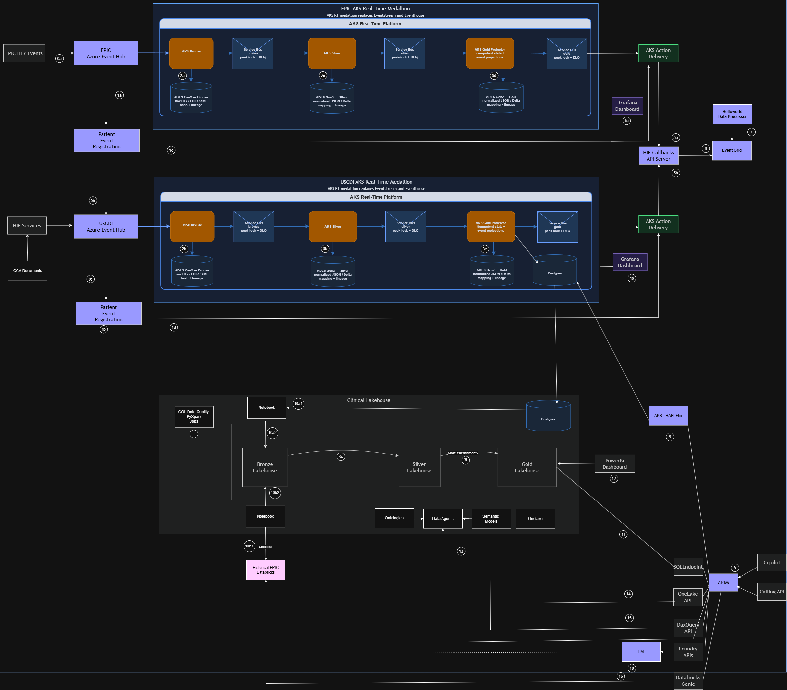

# Azure-Native AKS Medallion Architecture

## Purpose

This document presents two Azure-native AKS options for the HIE real-time
medallion architecture. **Approach 2 is the Changes-10 design**: independent
internal Epic HL7 and external USCDI real-time pipelines use Java/Docker
workloads on AKS, PostgreSQL Gold, HAPI FHIR, and downstream Fabric
replication. The existing Fabric Clinical NRT Lakehouse remains in place.

1. **Approach 1: AKS + ADLS + ADX** replaces the Fabric real-time data plane
   with AKS processing, ADLS Gen2 Bronze/Silver storage, Service Bus stage
   handoffs, and Azure Data Explorer as the KQL/Eventhouse serving layer.
2. **Approach 2: AKS + PostgreSQL + Fabric replication** uses PostgreSQL as
   the operational Gold store and replicates approved data into Fabric/OneLake
   for governed analytical consumption. ADX is not required in this design.

Both approaches retain the same source and medallion boundaries:

```text
Internal Epic HL7 or external USCDI / HIE sources
  -> Event Hubs
  -> AKS ingress and Bronze writer
  -> Bronze in Azure Data Lake Storage Gen2
  -> Service Bus normalization queue
  -> AKS HL7/FHIR normalization
  -> Silver in Azure Data Lake Storage Gen2
  -> Service Bus projection queue
  -> AKS Gold projector
  -> Approach 1: Azure Data Explorer
     or Approach 2: PostgreSQL operational state
  -> Approach 2: AKS HAPI FHIR reads PostgreSQL
  -> Approach 2: Fabric Mirroring/CDC -> OneLake replica
     -> governed analytical consumers / Clinical NRT Lakehouse integration
  -> dashboards, APIs, rules, actions, and analytical consumers
```

Approach 1 removes Fabric from the real-time data plane. Approach 2 retains
Fabric as a read-only analytical replica and does not make Fabric the clinical
write path. Existing AKS-hosted API services, API Management, Entra ID,
monitoring, and downstream integrations can be retained or adapted in either
option.

## Summary

Use Azure Kubernetes Service (AKS) for custom ingestion, transformation,
validation, projection, and operational processing. Place a durable queue
between each independently recoverable processing stage. Store immutable raw
events in Bronze and validated normalized records in Silver.

In **Approach 1**, AKS materializes operational and event query projections
into a KQL-compatible Azure Data Explorer (ADX) database that serves as the
Eventhouse/Gold equivalent.

In **Approach 2**, the Gold projector commits FHIR event and current-state
projections to PostgreSQL. HAPI FHIR reads the operational database; approved
PostgreSQL data is replicated to Fabric for analytical use. A transactional
outbox and durable Gold/action delivery are required for downstream actions
but are not implemented yet.

The recommended messaging pattern uses:

- **Azure Event Hubs** for high-throughput source ingress and short-term stream
  replay.
- **Azure Service Bus** for durable work distribution, poison-message
  handling, delayed delivery, dead-letter queues, and stage-specific queues or
  topics.
- **KEDA on AKS** to scale queue-processing deployments from zero or from a
  small steady-state replica count based on queue depth.

Event Hubs and Service Bus solve different problems in this design. Event
Hubs should not be treated as a work queue, and Service Bus should not replace
Event Hubs for an Epic integration expected to sustain a very high event rate.
Both are useful: Event Hubs buffers the incoming stream, while Service Bus
coordinates recoverable processing steps.

## Architecture Approaches

| Dimension | Approach 1: AKS + ADLS + ADX | Approach 2: AKS + PostgreSQL + Fabric replication |
|---|---|---|
| Fabric role | No real-time data-plane dependency | Read-only mirrored analytical plane |
| Bronze | ADLS Gen2 | ADLS Gen2, separate Epic and USCDI flows |
| Silver | ADLS Gen2, versioned JSON/Delta | ADLS Gen2, versioned JSON/Delta |
| Operational current state | ADX materialized/current-state views | Azure Database for PostgreSQL |
| Event and time-series history | ADX | PostgreSQL event projection; ADLS lineage |
| Transactional application reads | API service over approved ADX or read-model endpoint | Read-only HAPI FHIR and approved APIs over PostgreSQL |
| Durable processing handoff | Service Bus | Service Bus |
| Fabric copy | None | Read-only PostgreSQL replica in OneLake through Mirroring/CDC |
| Best fit | Replacing Fabric real-time processing and KQL serving | Applications requiring PostgreSQL state while retaining Fabric analytics |
| Additional operating concerns | ADX ingestion and reconciliation | PostgreSQL HA/PITR, WAL/CDC capacity, replication lag, and Fabric schema support |

### Approach 1: AKS + ADLS + ADX

The AKS Gold projector sends idempotent event projections to ADX. ADX serves
KQL dashboards, operational event queries, rules, and governed API read
models. ADLS Gen2 remains the durable Bronze and Silver source for replay and
historical reconstruction.



### Approach 2: AKS + PostgreSQL + Fabric replication

Changes-10 focuses on two independent, similarly structured pipelines:
**HL7 internal - Epic RT** and **HL7 external - USCDI RT**. Each receives
events through its Event Hub and uses AKS Bronze, Silver, and Gold Java
containers, ADLS storage, and Service Bus handoffs. Gold commits PostgreSQL
state; HAPI FHIR on AKS reads that PostgreSQL projection. Fabric receives a
read-only copy via a supported mirroring/CDC mechanism. The Clinical NRT
Lakehouse and its established downstream consumers remain in Fabric.



The Gold event and current-state tables commit in one transaction. A future
transactional outbox should reliably hand Gold/action messages to Service Bus;
an outbox publisher, ADLS Gold write, action delivery and Fabric replication
are not implemented by the Java service. Native Fabric Mirroring or an
approved CDC/ADF adapter must be separately validated and deployed.

The PostgreSQL database is authoritative for operational writes and
transactional reads. Fabric contains a read-only replica for SQL, semantic,
Power BI, and AI/agent analytics. Consumers must not write through the Fabric
copy.

The earlier detailed diagram below is an alternative illustration, not the
exact Changes-10 topology; it includes ADX and an outbox that are not
dependencies of the simplified design.


## Service Mapping

| Fabric capability | Proposed Azure-native equivalent | Notes |
|---|---|---|
| Fabric workspace | Azure resource groups, subscriptions, Entra groups, and Git-managed deployment boundaries | Separate production data planes by environment and, if required, by medallion layer. |
| Eventstream | Event Hubs plus AKS consumers or a managed ingestion adapter | AKS owns the contract translation and checkpoint visibility. |
| Bronze Eventhouse | ADLS Gen2 raw zone | Immutable, replayable source representation partitioned by source, event date, and entity or tenant. |
| Bronze/Silver orchestration | Service Bus topics or queues | Durable stage handoffs with dead-lettering and independently scaled consumers. |
| Fabric transformation | AKS normalization services | Decode, parse, validate, map terminology, and publish normalized records. |
| Silver Eventhouse | ADLS Gen2 normalized zone, preferably Delta Lake | Versioned, queryable, idempotently materialized normalized data. |
| Eventhouse / Gold | ADX in Approach 1; PostgreSQL operational state and event projections in Approach 2 | ADX is not a dependency of the Changes-10 design. |
| Operational system of record | No separate transactional store in Approach 1 | Azure Database for PostgreSQL in Approach 2. |
| Real-Time Dashboard | Azure Data Explorer Dashboards or Azure Managed Grafana | Select based on audience and operating model. |
| Activator | AKS rule processor, Azure Functions, or Azure Stream Analytics where appropriate | Service Bus carries resulting actions durably to approved delivery systems. |
| Fabric notebook/materialization | AKS Data API jobs, Databricks, or scheduled Delta jobs | Choose only if durable batch or complex historical transformation is required. |
| Fabric Lakehouse / OneLake | ADLS/Delta in Approach 1; Fabric mirrored PostgreSQL plus optional governed transformations in Approach 2 | Approach 2 treats the Fabric copy as a downstream read-only analytical replica. |
| Power BI semantic layer | Power BI over ADX/ADLS in Approach 1; Power BI over the mirrored Fabric model in Approach 2 | Preserve governed semantic models and row/object-level security. |
| APIM and HAPI FHIR | APIM and AKS services | The existing HAPI server supports Fabric Eventhouse or PostgreSQL Gold; an ADX HAPI backend is not implemented. |

## Detailed Data Flows

### Approach 1: AKS + ADLS + ADX

```text
                              Azure Monitor / Log Analytics
                                      ^ metrics and traces
                                      |
Epic / interface engines ----------+ |
  FHIR / HL7 / JSON                 | |
                                  v |
                       +------------------------+
                       | Azure Event Hubs       |
                       | partitioned ingress    |
                       +-----------+------------+
                                   | checkpointed consumer
                                   v
                       +------------------------+
              AKS      | Bronze Ingest Service  |
                       +-----------+------------+
                                   | raw blob + manifest
                                   v
                       +------------------------+
                       | ADLS Bronze            |
                       | original payload       |
                       +-----------+------------+
                                   | publish after commit
                                   v
                       +------------------------+
                       | Service Bus Topic      |
                       | bronze-ready / DLQ     |
                       +-----+-------------+----+
                             |             |
                             v             v
                    +----------------+   other subscriptions
             AKS    | Normalizer     |
                    +-------+--------+
                            | validated normalized records
                            v
                    +----------------+
                    | ADLS Silver    |
                    | Delta/Parquet  |
                    +-------+--------+
                            | publish after commit
                            v
                    +------------------------+
                    | Service Bus Topic      |
                    | silver-ready / DLQ     |
                    +-----------+------------+
                                v
                    +------------------------+
             AKS    | Gold Projector / Rules |
                    +-----------+------------+
                                |
                 +--------------+----------------+
                 v                               v
       +-------------------+            +----------------------+
       | Azure Data Explorer|           | Action Outbox / SB   |
       | Eventhouse / Gold  |           | durable notifications|
       +---------+---------+            +----------+-----------+
                 |                                 |
        +--------+---------+                       v
        |                  |              approved downstreams
        v                  v
   KQL dashboards   AKS APIs -> APIM
```

### Approach 2: AKS + PostgreSQL + Fabric replication

```text
Epic HL7 -> Epic Event Hub ----+
                               +-> AKS Bronze -> ADLS Bronze -> Service Bus
USCDI/HIE -> USCDI Event Hub --+   -> AKS Silver -> ADLS Silver -> Service Bus
                                   -> AKS Gold -> PostgreSQL event + current state
                                        |               |
                                        |               +-> AKS HAPI FHIR -> APIM
                                        +-> ADLS Gold and Service Bus Gold/actions (planned)
                                                        |
PostgreSQL -> Fabric Mirroring/CDC (planned) -> OneLake replica
           -> existing Clinical NRT Lakehouse / governed analytical consumers
```

The two lines represent **separate logical pipelines**, not one merged Event
Hub or queue. Choose separate databases or define tenant/source isolation and
collision-free FHIR IDs before sharing a database. Fabric replication is
asynchronous and does not change PostgreSQL ownership. The Fabric replica is
not an application write target. Transactional state and an action outbox must
eventually commit together; neither an outbox nor the replicator is implemented.

### Implementation status

The existing Java image defaults to the original ADX Gold backend. Setting
`GOLD_BACKEND=postgresql` on the Gold role writes an event and current FHIR
resource to PostgreSQL in one transaction. `GOLD_STORE=postgresql` selects the
PostgreSQL-backed, **read-only** HAPI `RestfulServer`; the existing Eventhouse
backend remains the default. This is a custom projection, not HAPI JPA storage.
Schema, configuration, contract and deployment gaps are described in the
[AKS service README](../services/aks-medallion/README.md).

HL7/USCDI parsing, approved FHIR mappings and validation, ADLS Gold, a
transactional outbox/Gold queue publisher, action delivery, PostgreSQL
provisioning and Fabric replication are **not implemented**. The existing
Bicep and deployment script still provision the original ADX design and do
not deploy the Changes-10 PostgreSQL/Fabric topology.

## Component Responsibilities

### Azure Event Hubs

Event Hubs is the external ingestion boundary. It:

- decouples Epic and other publishers from downstream processing;
- partitions events for parallel consumption;
- retains events for a bounded replay window;
- captures event time, source event ID, correlation ID, partition, sequence
  number, and schema version in the event envelope; and
- supports an ordered replay within a partition.

Choose a partition key, such as source system plus message or patient context,
only after throughput and ordering requirements are measured. A partition key
must distribute load; it must not become a single-patient or single-source
hotspot.

### AKS Bronze Ingest Service

The Bronze service consumes Event Hubs using a checkpoint store. It writes the
unaltered encoded payload and a small metadata manifest to ADLS Gen2. It must
not reject an event merely because the clinical payload cannot yet be parsed.

The Bronze commit includes:

- source payload unchanged;
- source envelope;
- payload hash;
- source event ID and correlation ID;
- Event Hubs partition, sequence, and enqueue time;
- ingestion time;
- payload size and schema/envelope version; and
- optional tenant or interface identifier.

After the ADLS write is committed, the service publishes a small
`bronze-ready` message containing the blob URI and identifying metadata. The
message should not contain the full clinical payload.

### Azure Service Bus

Service Bus coordinates processing rather than serving as the Bronze store.
Recommended entities are:

1. `bronze-ready`: normalize committed raw events.
2. `silver-ready`: project committed normalized records and evaluate rules.
3. `gold-ready`: publish committed Gold work (planned).
4. `actions`: deliver approved alerts or workflow actions (planned).
5. One dead-letter queue for each work entity's failed messages.

Use topics when more than one independent subscriber needs the same stage
event. Use queues when a stage has one consumer group. Enable duplicate
detection for the maximum useful window, set a finite delivery count, and
require dead-letter reason metadata that does not expose PHI.

Service Bus sessions can preserve order by patient, encounter, or another
approved key where processing order is required. They reduce parallelism and
should be used only for workflows that truly require ordering. Idempotency
must still be implemented because Service Bus provides at-least-once delivery.

### AKS Normalization Service

The normalization deployment:

1. receives the Bronze manifest from Service Bus;
2. reads the exact Bronze blob;
3. validates the envelope and source;
4. decodes Base64 where applicable;
5. parses HL7 or FHIR according to a versioned parser;
6. validates mandatory fields and supported message types;
7. maps approved fields into the versioned canonical Silver model;
8. records validation and terminology results;
9. writes the normalized object and metadata to Silver; and
10. completes the Service Bus message only after the Silver commit succeeds.

Supported FHIR resources and HL7 versions should be allow-listed. Unknown but
valid message types belong in a quarantine or unsupported path with a clear
operator action, not in the live clinical projections.

### Planned Silver patient identity rules with HAPI MDM

The proposed integration uses a HAPI FHIR JPA server backed by PostgreSQL to
link incoming FHIR R4 Patient source resources to MDM Golden Patient resources.
An MDM "Golden Resource" is HAPI's master identity resource; it is **not** the
medallion Gold layer. This integration is not implemented: today's Silver
processor accepts JSON objects and does not validate FHIR, perform matching,
or hold ambiguous patients for review.

The intended rules for both source pipelines are:

1. Accept one FHIR R4 resource per event. Validate and map incoming HL7 and
   USCDI data to FHIR upstream; these mappings are not yet implemented.
2. Configure one approved enterprise identifier system URI for Patient
   matching. The deployment owner must provide the URI; do not assume that a
   FHIR logical ID is an enterprise identifier or that HAPI generates one.
   The organization remains responsible for issuing and governing the
   enterprise identifier values.
3. Use only an exact match on the configured identifier system **and** value
   for automatic Patient linking. Do not automatically link or merge based on
   name, date of birth, address, phone, or other demographic similarity.
   Separate source Patient records may link to the same MDM Golden Patient.
4. Validate the required identifier before submitting a Patient to MDM. Hold
   missing, invalid, conflicting, or ambiguous identifiers for authorized
   review; never send unresolved records to Gold. Hold resources with Patient
   references when their identity cannot be resolved safely. Define and
   implement the durable hold, review, correction, and re-drive workflow.
5. HAPI MDM processing may be asynchronous. A successful FHIR write or a
   temporarily absent link is not proof of resolution. Check all pages of
   `$mdm-query-links` and the relevant
   `$mdm-duplicate-golden-resources` results; release only after the configured
   acceptance checks identify one unambiguous MATCH and no unresolved
   conflicting links. Retry transient failures separately from manual review.
6. Preserve source lineage and map references consistently to the approved
   patient identity. Protect MDM operations and review data with least
   privilege, audit access and decisions, and exclude PHI from operational
   logs and queue diagnostics.

Separate MDM databases do not automatically share patient links. Decide
whether the two pipelines use an approved shared identity domain or how their
identities are reconciled before relying on cross-pipeline deduplication.

The following is an **illustrative, unvalidated** HAPI MDM rules template, not
a deployed configuration. Replace the placeholder in both locations with the
same approved URI and validate it against the pinned HAPI JPA version before
use. `candidateSearchParams` finds possible candidates; the `IDENTIFIER`
matcher and EID configuration restrict the intended identity decision to the
configured enterprise system. HAPI EID behavior must also be tested because it
can establish links independently of the ordinary `matchResultMap`.

```json
{
  "version": "1",
  "mdmTypes": ["Patient"],
  "candidateSearchParams": [
    { "resourceType": "Patient", "searchParams": ["identifier"] }
  ],
  "matchFields": [
    {
      "name": "enterprise-identifier",
      "resourceType": "Patient",
      "resourcePath": "identifier",
      "matcher": {
        "algorithm": "IDENTIFIER",
        "identifierSystem": "https://example.invalid/replace-with-approved-system",
        "exact": true
      }
    }
  ],
  "matchResultMap": {
    "enterprise-identifier": "MATCH"
  },
  "eidSystems": {
    "Patient": "https://example.invalid/replace-with-approved-system"
  }
}
```

By default HAPI's EID settings prevent changing an existing EID and multiple
EIDs from the same system on a resource. Confirm these settings in the chosen
version and define a governed correction process rather than disabling them
without review. Manual MDM link decisions take precedence over automatic
links. A `POSSIBLE_MATCH` or `POSSIBLE_DUPLICATE` requires review; `NO_MATCH`
alone is not permission to promote a record. HAPI may create a new Golden
Patient for a new identity, but the integration must verify the resulting
link and required identifier before release.

Before any clinical use, test with synthetic records for same and different
systems and values, missing and multiple identifiers, casing and formatting,
concurrent arrivals, delayed links, duplicates, manual decisions, corrections,
and replay. Verify exact comparison behavior and review conflicting EIDs
against the selected HAPI version. Preserve Gold's existing source-version
ordering and replay protections when writing through FHIR APIs: HAPI's own
`meta.lastUpdated` is not a substitute for the source event version.

References: [HAPI MDM overview](https://hapifhir.io/hapi-fhir/docs/server_jpa_mdm/mdm.html),
[rules](https://hapifhir.io/hapi-fhir/docs/server_jpa_mdm/mdm_rules.html),
[enterprise identifiers](https://hapifhir.io/hapi-fhir/docs/server_jpa_mdm/mdm_eid.html),
and [operations](https://hapifhir.io/hapi-fhir/docs/server_jpa_mdm/mdm_operations.html).

### Azure Data Lake Storage Gen2

ADLS Gen2 provides the durable medallion store.

#### Bronze

- immutable, append-only source representation;
- partition by source, event date, and optionally interface;
- retain sufficient lineage for audit and controlled replay;
- protect with private endpoints, versioning, soft delete, lifecycle policy,
  and least-privilege access; and
- do not expose directly to broad analytical or application identities.

#### Silver

- one versioned normalized representation per accepted source event;
- include source event ID, Bronze URI, parser/mapping version, event time,
  ingestion time, validation status, and terminology version;
- prefer Delta tables when update, merge, schema evolution, and historical
  query requirements justify them;
- use encrypted storage and limit direct access to processing and governed
  analytical identities; and
- retain unsupported, invalid, or partially mapped events separately with a
  sanitized reason code.

#### Data lifecycle

Retention for Bronze and Silver should be driven by clinical records,
litigation, privacy, and regional requirements. Lifecycle tiering can reduce
cost, but expiry and rehydration must preserve replay commitments. Do not use a
single generic retention value without data-governance approval.

### AKS Gold Projector

The Gold projector materializes approved operational projections. Examples
include patient, encounter, observation, event status, data-quality, and
monitoring views. It:

- reads only committed Silver records;
- applies versioned business and clinical projection rules;
- in Approach 1, writes append-only events and approved current-state
  projections to ADX;
- in Approach 2, transactionally writes an FHIR event and current-state
  projection to PostgreSQL; an action outbox is a future requirement;
- maintains a stable event ID for idempotent effects across ADX, PostgreSQL,
  Service Bus, and API consumers;
- publishes rule/action candidates to a durable action path; and
- exposes checkpoint, lag, and projection-failure metrics.

For Approach 2, do not update PostgreSQL and publish the corresponding action
as two independent writes. Implement and commit an outbox intent in the same
PostgreSQL transaction, then use a retryable publisher to deliver to Service
Bus. This action path is not yet implemented.

### Azure Database for PostgreSQL: Approach 2

Azure Database for PostgreSQL Flexible Server is the operational source of
truth for the AKS application in Approach 2. It provides:

- transactional current-state tables for approved clinical and event entities;
- event history and current-state records in one transaction;
- a future transactional outbox for downstream action publication;
- primary/unique constraints and indexes supporting idempotent FHIR/API reads;
- zone-redundant high availability where the region and SKU support it;
- point-in-time recovery, backups, encryption, private networking, and
  managed-identity access where supported by the client design; and
- a bounded, approved schema eligible for Fabric replication.

PostgreSQL design must account for connection pooling, schema migration,
partitioning, retention, vacuum/autovacuum, HA failover behavior, and database
backup/recovery. Bronze and Silver in ADLS remain the replayable source; do not
make PostgreSQL the only retained copy of the source event.

The HAPI layer queries the current PostgreSQL FHIR projection through a
read-only database identity. It does not expose unrestricted SQL access or
write directly to HAPI JPA tables.

### Fabric Mirroring and CDC Replication: Approach 2

Fabric is downstream of PostgreSQL in Approach 2. Use a supported native
Fabric Mirroring capability when available for Azure Database for PostgreSQL;
otherwise deploy an approved CDC/ADF or equivalent adapter.

The replication path must:

- replicate only approved tables or views;
- retain PostgreSQL as the sole operational write system;
- monitor replication lag, failures, schema drift, and restart position;
- preserve a resumable change cursor or replication slot;
- protect credentials and connectivity with Entra, private networking, and
  least-privilege permissions;
- validate supported data types, keys, DDL, row counts, and delete behavior;
- control logical-replication/WAL retention to avoid storage growth; and
- define the consequence of replication lag for analytical consumers.

The resulting Fabric mirrored database is a read-only operational copy in
OneLake. Warehouse/Lakehouse transformations, semantic models, Power BI,
data agents, and approved AI experiences consume the replica according to
Fabric governance. They must not be represented as synchronous clinical
write-back paths.

### Azure Data Explorer: Eventhouse Equivalent

In Approach 1, ADX replaces Fabric Eventhouse for KQL-based operational and
event analytics. ADX is not required for the simplified Changes-10 Approach 2.
The Approach 1 ADX database contains:

- append-only canonical event tables;
- functions or materialized views for current-state projections;
- retention and cache policies by table;
- row-level security or database/view restrictions where supported by the
  approved access pattern;
- ingestion failure and latency monitoring; and
- dashboards for clinical operations, interface health, and reconciliation.

Use update policies only for deterministic, low-cost projections. Put complex
or versioned business transformation in the AKS Gold projector so behavior is
testable in application code and can be rolled back independently.

ADX is an event and operational analytics serving layer, not a general
clinical system of record. Access should be mediated for external applications
by an API service and API Management rather than granting broad direct ADX
permissions.

### AKS Rule and Action Processing

Rules should be evaluated against governed Gold data or selected events.
Detection and action delivery are separate stages:

1. a rule evaluator emits an action intent;
2. the intent is persisted in an outbox or dedicated action table;
3. a Service Bus publisher delivers the intent after durable commit;
4. an action worker performs the approved integration with bounded retries;
5. failed deliveries move to a dead-letter queue; and
6. operators re-drive only after reviewing the failure and its clinical
   significance.

This avoids assuming that an alerting engine is a durable clinical delivery
system. Rules require explicit ownership, versioning, approval, audit, rate
limits, test fixtures, and a safe disable path.

### Kubernetes Hosting

Recommended AKS workloads:

- `bronze-ingest`: Event Hubs consumer and raw writer;
- `normalizer`: Bronze-to-Silver worker;
- `gold-projector`: Silver-to-ADX worker in Approach 1, or
  Silver-to-PostgreSQL worker in Approach 2;
- `outbox-publisher`: planned Approach 2 publisher for durable Service Bus
  action delivery;
- `rule-evaluator`: approved detections, if not implemented in another engine;
- `action-worker`: Service Bus action consumer;
- `reconciler`: cross-stage counts and replay orchestration; and
- API workloads, including HAPI FHIR or other read adapters.

Use separate deployments for scaling and operational independence. Run
Kubernetes Jobs for controlled historical reprocessing rather than coupling
replay to the steady-state consumers.

## AKS Autoscaling

Use KEDA scalers for:

- Service Bus queue depth and age;
- Event Hubs lag, where the selected autoscaling metric is accurate; and
- optionally scheduled minimum capacity for predictable clinical windows.

Apply:

- minimum and maximum replica limits;
- CPU and memory requests/limits;
- pod disruption budgets;
- node pools separated by workload class where justified;
- spot nodes only for interruption-tolerant workloads; and
- backpressure when ADLS, ADX, Service Bus, or a downstream API is throttled.

Autoscaling does not replace load testing. Maximum service bus concurrency,
Event Hubs partition count, ADLS write patterns, ADX ingestion capacity,
Approach 2 PostgreSQL connections/WAL, Fabric replication capacity, and
downstream limits should be sized from measured peak rate and recovery
requirements.

## Delivery Semantics and Idempotency

The platform should assume **at-least-once** delivery end to end.

Every stage derives or carries a stable event identity:

```text
eventKey = sourceSystem + sourceEventId + messageType
```

If the source cannot provide a trustworthy event ID, derive one from an
approved canonical hash over immutable envelope fields. Never hash mutable
receive timestamps or processing attempts.

Each stage must:

- detect repeated event keys;
- avoid duplicate current-state effects;
- preserve the original payload and lineage;
- record whether the repeat was ignored, replaced, or rejected;
- distinguish a redelivered message from a new clinical version; and
- make downstream requests idempotent where an endpoint supports an
  idempotency key.

Storage and queue publication cannot be treated as one transaction. The safe
pattern is a durable stage record plus an outbox or equivalent publisher. A
background publisher retries unsent records, and a reconciler detects gaps
between stored records and enqueued work.

In Approach 2, the implemented PostgreSQL event and current-state changes
share one transaction. A future local outbox **must** share that transaction
when actions are added. Delivery to Service Bus or another downstream remains
at least once and requires stable identities and idempotent consumers. Fabric
replication is an independent read-only projection, not part of the clinical
write transaction.

## Failure Handling

| Failure | Expected behavior |
|---|---|
| Event Hubs unavailable | Publisher retries with source controls; AKS resumes from its last checkpoint. |
| Bronze write fails | Do not checkpoint or publish `bronze-ready`; retry until transient capacity/storage recovers. |
| Normalization fails permanently | Preserve Bronze, record a sanitized error, dead-letter the queue message, and route to quarantine. |
| Silver write fails | Do not complete the queue message; retry with the same event identity. |
| Service Bus publish fails after storage commit | Outbox/publisher retries or reconciler republishes the committed stage event. |
| ADX throttles | Retry according to ingestion status and back off; do not create duplicate Gold effects. |
| ADX unavailable | Queue/checkpoint remains pending; calculate backlog and recovery time before scaling. |
| PostgreSQL write fails | Roll back event and current state; retry with the same event identity. |
| PostgreSQL outbox publisher fails | Retain the committed outbox row and retry; do not create a second state effect. |
| Fabric replication stops or falls behind | Continue PostgreSQL operations, alert on lag, preserve the replication cursor/WAL safely, and repair the analytical copy without replaying writes into PostgreSQL. |
| Downstream action fails | Retry only approved transient failures; dead-letter permanent or policy-related failures. |
| Malformed or unsupported payload | Keep raw Bronze lineage, route to quarantine, and alert on volume or trend. |

## Security Architecture

- Use Microsoft Entra workload identity for AKS broker/storage access; do not
  deploy service principal secrets or Service Bus/Event Hubs connection
  strings. The current PostgreSQL clients require a database password from an
  approved secret mechanism; Entra token authentication is future work.
- Grant each workload only the role it needs for its Event Hubs entity, storage
  container/path, Service Bus entity, PostgreSQL database/schema, ADX
  database/table, and Fabric item.
- Use private endpoints and private DNS for storage, Service Bus, Event Hubs,
  PostgreSQL, ADX, applicable Fabric connectors/gateways, Key Vault, Container
  Registry, and AKS API access where the selected service and network topology
  require them.
- Disable local authentication for broker and storage resources unless a
  documented exception requires it.
- Use Azure Key Vault with workload identity only for configuration that cannot
  use native managed identity.
- Apply Pod Security Admission, restricted network policies, signed and
  vulnerability-scanned images, digest-pinned deployment images, and private
  ACR integration.
- Keep PHI out of logs, queue names, Kubernetes object names, telemetry
  dimensions, exception messages, and dead-letter reason fields.
- Encrypt at rest and in transit; use customer-managed keys only when required
  and after validating service compatibility and operations.
- Separate operators, deployers, replay authorities, clinical data readers,
  and audit readers with Entra groups and Azure RBAC.
- In Approach 2, use a dedicated replication identity with read/CDC rights and
  no clinical write permission. Fabric consumers receive read access to the
  mirrored/curated scope, never PostgreSQL write roles.

## Observability and Operations

Create one end-to-end correlation trail from ingress to action without placing
PHI in telemetry:

- event key or opaque correlation ID;
- Bronze blob commit time;
- queue enqueue and receive times;
- normalization and mapping version;
- Silver commit time;
- Approach 1 ADX ingestion operation and event commit time;
- Approach 2 PostgreSQL event/current-state commit identifier and, when implemented, outbox status;
- Approach 2 Fabric replication checkpoint and observed lag;
- action enqueue, delivery, retry, and terminal outcome; and
- workload release version and replica identity where useful.

Required operational measures include:

- Event Hubs ingress rate, publish errors, and consumer lag;
- oldest Bronze, normalization, and projection message age;
- Service Bus active/dead-letter counts and delivery attempts;
- parse, validation, quarantine, and mapping failure rates;
- Bronze/Silver/Gold counts by reconciliation window;
- Approach 1 ADX ingestion latency, failures, throttling, query latency, and health;
- Approach 2 PostgreSQL connection saturation, transaction latency, deadlocks,
  WAL/replication-slot growth, failover, and backup/PITR health;
- Fabric Mirroring/CDC lag, cursor state, schema failures, rejected tables, and
  reconciliation counts for Approach 2;
- AKS restarts, saturation, pod readiness, and KEDA scaling events;
- FHIR/API latency, error rate, and authorization denials; and
- rule evaluation, action delivery, suppression, and operator action audit.

Alert on symptoms with ownership and runbooks. Queue depth alone is not enough:
measure backlog age and compare it to the agreed recovery objective.

## Resilience and Regional Recovery

Before production selection, set measurable recovery objectives for each stage.
Recommended options include:

- paired or active-secondary Event Hubs where source publishing can support it;
- Service Bus namespace replication or a documented cutover mechanism;
- ADLS geo-redundant storage and an approved second-region recovery process;
- a second ADX cluster/database strategy based on RTO/RPO and cost;
- Approach 2 zone-redundant PostgreSQL and tested backup/restore, failover, and
  replication-cursor recovery;
- AKS deployed with availability zones and a separate recovery cluster
  definition; and
- immutable Bronze retention as the reconstruction source.

Cross-region failover must address duplicate detection, partition and sequence
continuity, replay starting points, rule/action suppression, and consumer
switch authority. Deploying duplicate regional resources alone is not a tested
recovery architecture.

## Cost Considerations

The major cost drivers are:

- AKS node pools and reserved/elastic capacity;
- Event Hubs throughput units or processing units and retention;
- Service Bus premium capacity and message operations;
- ADLS capacity, transactions, lifecycle tiering, and transfer;
- ADX compute and storage SKU, cache, and ingestion;
- Approach 2 PostgreSQL compute, high availability, storage, backup, and I/O;
- Approach 2 Fabric capacity, Mirroring/CDC operations, connectivity, and
  OneLake storage;
- Log Analytics ingestion and retention;
- private endpoints, NAT/firewall egress, and network transfer; and
- API Management and monitoring services.

Service Bus Premium is appropriate where predictable network isolation,
capacity, and production workload requirements apply. For a lower-volume POC,
Standard tier may be sufficient if its networking and feature limitations are
accepted, but the production decision must be explicit.

## Proposed Deployment Boundaries

| Boundary | Recommended contents |
|---|---|
| Shared platform | networking, private DNS, AKS, ACR, Key Vault, monitoring, policy |
| Ingress | Event Hubs, source identities, capture/checkpoint resources |
| Data platform | ADLS Bronze/Silver/Gold, selected ADX or PostgreSQL Gold, Fabric mirrored data where selected, lifecycle and data permissions |
| Processing | Service Bus, AKS workloads, KEDA, deployment identities |
| Serving | HAPI FHIR/API adapters, APIM, dashboards, consumer identities |
| Replication (Approach 2) | Fabric Mirroring/CDC adapter, replication identity, lag monitoring, and read-only governance |
| Operations | alerts, runbooks, reconciliation reports, replay governance |

Use separate subscriptions or resource groups only where isolation, billing,
quotas, regulatory requirements, or operational ownership justify them. Avoid
one resource group per logical service without a management reason.

## Migration Plan

### Phase 0: Contract and baseline

- Inventory Fabric workspaces, Eventstreams, Eventhouse databases/tables,
  Activator rules, notebooks, identities, and consumers.
- Capture current event size, peak throughput, latency, retention, failure,
  replay, and query requirements.
- Freeze and version the event envelope and Bronze-to-Silver mappings.
- Identify which Fabric behavior is required versus incidental.

### Phase 1: Parallel Bronze

- Deploy Event Hubs, ADLS Bronze, Service Bus, and the AKS Bronze ingester.
- Publish a controlled duplicate or test stream to Azure and Fabric.
- Prove payload equality, metadata lineage, ordering assumptions, and
  reconciliation before enabling normalization.

### Phase 2: Parallel Silver and Gold

- Run AKS normalization and the Gold projector in parallel with Fabric.
- Reconcile record counts, values, validation outcomes, and current-state
  projections.
- For Approach 1, validate every ADX KQL consumer against the new schemas and
  functions.
- For Approach 2, validate PostgreSQL event and current state, eventual
  transactional outbox delivery, and the Fabric mirror as distinct
  consistency checkpoints.
- Build quarantine, dead-letter, replay, and rollback runbooks.

### Phase 3: Consumer cutover

- Move event dashboards to the selected approved backend or Managed Grafana
  after query acceptance.
- For Approach 2, move current-state API/HAPI reads to PostgreSQL and expose
  replicated Fabric data only to approved analytical consumers.
- Cut API and HAPI read paths to the selected approved read model through APIM.
- Migrate rule/action paths with delivery disabled, then enable by approved
  rule cohort.
- Run rollback-capable dual reads and compare query results during a bounded
  observation window.

### Phase 4A: Fabric real-time retirement

- Stop Fabric producers only after reconciliation and consumer acceptance.
- Retain source and transformed data for the approved transition period.
- For Approach 1, remove Fabric identities, gateways, capacities, and
  workspaces using a dependency-verified retirement checklist.
- For Approach 2, retire Eventstream/Eventhouse real-time processing but retain
  the explicitly approved Fabric Mirroring, Lakehouse/Warehouse, and consumer
  boundary.
- Preserve evidence for clinical, security, and operational sign-off.

### Phase 4B: Fabric replication steady state

For Approach 2, retain only the approved Fabric analytical boundary. Establish
owners for mirrored tables, replication health, schema evolution, semantic
models, capacity, and consumer access. Disable any remaining Fabric real-time
write or event-processing path unless it is explicitly retained by architecture
decision.

## Acceptance Criteria

1. **Losslessness:** Bronze payload hashes match the source stream; metadata
   permits deterministic replay.
2. **Durability:** simulated worker and node failures do not require republishing
   completed source events.
3. **Idempotency:** replaying an event does not create duplicate Silver or
   current-state Gold effects.
4. **Poison handling:** malformed data is preserved, quarantined, visible, and
   does not block healthy events.
5. **Recovery:** backlog recovery meets the agreed throughput and lag target.
6. **Freshness:** p50/p95 source-to-Gold/source-to-API latency, plus
   PostgreSQL-to-Fabric lag for Approach 2, meet the approved SLOs.
7. **Compatibility:** Approach 1 KQL queries and consumers produce expected
   results against ADX; Approach 2 PostgreSQL and mirrored Fabric row/state
   counts agree for approved windows.
8. **Security:** unauthorized identities cannot read raw payloads, publish to
   broker entities, query clinical projections, or invoke replay.
9. **Operations:** dashboards, alerts, owners, dead-letter re-drive steps, and
   rollback procedures are exercised.
10. **Clinical and data governance:** supported message types, mappings,
    terminology versions, retention, and access policies are approved.

## Decisions Required

The following decisions should be made before implementation:

1. **Stream versus queue boundary:** validate whether Event Hubs receives all
   external events or whether selected sources can publish directly to
   Service Bus.
2. **AKS operating model:** select Approach 1 (ADLS + ADX) or Approach 2
   (PostgreSQL + Fabric replication) for operational Gold/current state.
3. **Silver format:** choose Delta Lake when merge/schema/history requirements
   justify a runtime dependency; otherwise use versioned Parquet/JSON plus a
   catalog.
4. **Gold state model:** define the ADX serving model for Approach 1 and
   the PostgreSQL table/outbox model for Approach 2.
5. **Replication mechanism:** confirm supported Fabric Mirroring for the
   selected PostgreSQL service/tier/region, or approve a CDC/ADF adapter and
   its operational ownership.
6. **State semantics:** define append-only event projections versus updateable
   current-state records.
7. **Ordering:** identify workflows requiring per-key order and the associated
   throughput trade-off of Service Bus sessions.
8. **Rule engine:** use an AKS service, Azure Functions, Azure Stream Analytics,
   or an approved external rules platform based on complexity and ownership.
9. **Retention and privacy:** approve Bronze, Silver, queue, log, ADX,
   PostgreSQL, Fabric mirror, backup, and dead-letter retention.
10. **Availability:** establish RTO/RPO and the multi-region recovery strategy.
11. **Replay authority:** define who may replay which windows and how actions are
   suppressed or deduplicated during replay.
12. **Existing consumers:** inventory every direct KQL, Power BI, notebook,
    Activator, API, or OneLake dependency before removing Fabric.

## Platform Comparison

| Dimension | AKS-based real time | Microsoft Fabric Real-Time Intelligence | Azure Databricks real time / Lakeflow |
|---|---|---|---|
| **Best fit** | Custom, high-control streaming and integration workloads | Fast delivery of operational real-time analytics with minimal platform management | Lakehouse-centric ingestion, transformation, machine learning, and analytics |
| **Architecture** | Event Hubs + AKS/KEDA + Service Bus + ADLS; ADX or PostgreSQL Gold with Fabric replica | Event Hubs + Eventstream + Eventhouse + Activator + OneLake | Kafka/Event Hubs + Structured Streaming/Lakeflow + Delta Lake + SQL Warehouse |
| **Primary strength** | Maximum flexibility and portability | Low-code, integrated real-time experience | Unified batch, streaming, Delta, governance, and data engineering |
| **Pros** | Full control over parsers, retries, ordering, APIs, and replay; any language or framework; KEDA scaling; clear stage boundaries; reusable AKS skills | Rapid implementation; managed Eventstream, KQL Eventhouse, dashboards, and Activator; strong Power BI/OneLake integration; less infrastructure management | Mature streaming transformations; strong exactly-once Delta writes; ACID Bronze/Silver/Gold lakehouse; batch/stream convergence; notebooks, Lakeflow, Unity Catalog, ML, and quality controls |
| **Cons** | Highest operational burden; container, broker, cluster, networking, security, SRE, and upgrade ownership; idempotency and recovery must be engineered; larger deployment and testing surface | Proprietary deployment model; less control over internal processing and recovery; capacity economics and throttling; specialized permissions and API automation; Eventhouse is not a transactional store; Activator is not a complete durable delivery engine | Spark and streaming expertise required; cluster/job tuning remains; Event Hubs or Service Bus may still be needed; less natural for low-latency application APIs or durable work queues; continuous compute can be costly |
| **Operational complexity** | **High** | **Low–Medium** | **Medium–High** |
| **Implementation speed** | **Slower** | **Fastest for supported patterns** | **Medium** |
| **Customization** | **Highest** | **Medium–Low** | **High**, within the Spark/Databricks ecosystem |
| **Low-latency operational queries** | Excellent with ADX or another serving store | Excellent with Eventhouse/KQL | Good for many use cases, but ADX or another serving layer may be preferable for stringent event-query workloads |
| **Bronze/Silver/Gold support** | Explicitly custom-built | Native conceptual flow, but architecture-dependent | **Strongest native lakehouse alignment**, especially with Delta Live Tables/Lakeflow |
| **Replay and correction** | Fully controllable, but requires engineering | Managed patterns with platform-specific operational details | Strong checkpoints, Delta history, and recovery; replay still requires explicit design |
| **Durable action delivery** | Strong with Service Bus, outbox, and DLQ patterns | Requires an external durable delivery path behind Activator | Supported, but often best paired with Service Bus, Functions, or AKS |
| **Governance** | Azure RBAC, Entra, network controls, Key Vault, ADLS, and custom lineage | Centralized through Fabric workspaces, OneLake, and tenant administration | Strong Unity Catalog, Delta lineage, access policies, and audit |
| **Engineering skills** | Kubernetes, messaging, ADX, ADLS, application development, and SRE | KQL, Fabric, Eventstream, Power BI, and workspace administration | Spark, Python/Scala/SQL, Delta Lake, Databricks workflows, and Unity Catalog |
| **Portability / exit strategy** | High at the application layer; Azure managed-service dependencies remain | Lower; workload definitions and data-plane behavior are Fabric-specific | Moderate; Spark and Delta are portable, while Databricks tooling remains platform-specific |
| **Cost profile** | AKS, Event Hubs, Service Bus, ADLS, selected ADX or PostgreSQL/Fabric, monitoring, and APIM | Fabric capacity plus supporting Azure ingress/services; efficient when capacity is well utilized | Databricks DBUs, compute, storage, and Azure services; continuous streaming compute can be expensive |
| **Healthcare / PHI controls** | Strong control over networking, identity, logging, and processing boundaries, but more controls must be implemented and maintained | Strong platform controls; regional, private-access, tenant, and capacity requirements must be validated | Strong governance and identity controls; notebook, job, log, and private-connectivity behavior must be validated for PHI |
| **Key failure modes** | Pod eviction, checkpoint loss, duplicate processing, broker throttling, DLQ, partial ADLS commits, and ADX ingestion failure | Capacity throttling, update-policy failures, tenant permissions, workspace dependencies, and action delivery limits | Checkpoint mismatch, schema drift, small files, cluster restart, streaming lag, and downstream serving limitations |

### Selection Guidance

- **Choose AKS** when custom HL7/FHIR handling, API behavior, clinical rules,
  durable delivery, infrastructure control, or portability is the primary
  requirement.
- **Choose Fabric Real-Time Intelligence** when the goal is rapid KQL-based
  operational analytics, dashboards, Power BI, and governed real-time
  experiences with the least infrastructure engineering.
- **Choose Azure Databricks** when data-engineering transformation, batch and
  stream convergence, historical analytics, machine learning, Unity Catalog,
  and Delta Lake governance are the center of the solution.

For an HIE, a hybrid may be appropriate:

```text
Event Hubs
  -> Databricks/Lakeflow for scalable medallion data engineering
  -> Delta Lake Silver
  -> Azure Data Explorer for low-latency operational Gold and KQL
  -> AKS for APIs, FHIR access, custom rules, and delivery services
  -> Service Bus for actions, retries, and dead-letter handling
```

Fabric remains the fastest proof-of-concept path, Databricks is strongest for
an analytics-first lakehouse, and AKS is the most direct fit when custom
real-time processing and durable integration behavior are the dominant needs.

## Recommendation

Retain the common AKS ingress and processing platform:

- Event Hubs for source ingress;
- Service Bus topics and dead-letter queues for durable stage handoffs;
- KEDA-scaled AKS consumers for Bronze ingestion, normalization, projection,
  and actions;
- ADLS Gen2 for immutable Bronze and versioned Silver/Gold; and
- APIM in front of AKS-hosted read and FHIR API services.

Select the Gold and analytical path according to the operating requirement:

- **Approach 1** is preferred when the objective is full replacement of the
  Fabric real-time data plane and ADX current-state projections satisfy the API
  and transactional-read requirements.
- **Approach 2** is the Changes-10 direction: Epic and USCDI AKS pipelines
  project to PostgreSQL, AKS HAPI FHIR reads PostgreSQL, and Fabric retains its
  Clinical NRT Lakehouse and read-only analytical copy.

For Approach 2, PostgreSQL must be the operational source of truth. Fabric
Mirroring/CDC produces a read-only downstream replica and must not introduce a
second write path. Validate native PostgreSQL mirroring support in the target
Fabric region and tenant; otherwise implement the approved CDC/ADF adapter.

Both approaches preserve medallion semantics while making application
behavior, queue ownership, replay, deployment, and operations explicit in
Azure. Fabric real-time components should be removed only after data
equivalence, consumer compatibility, reliability, security, and governance
controls have been proven in parallel operation.
